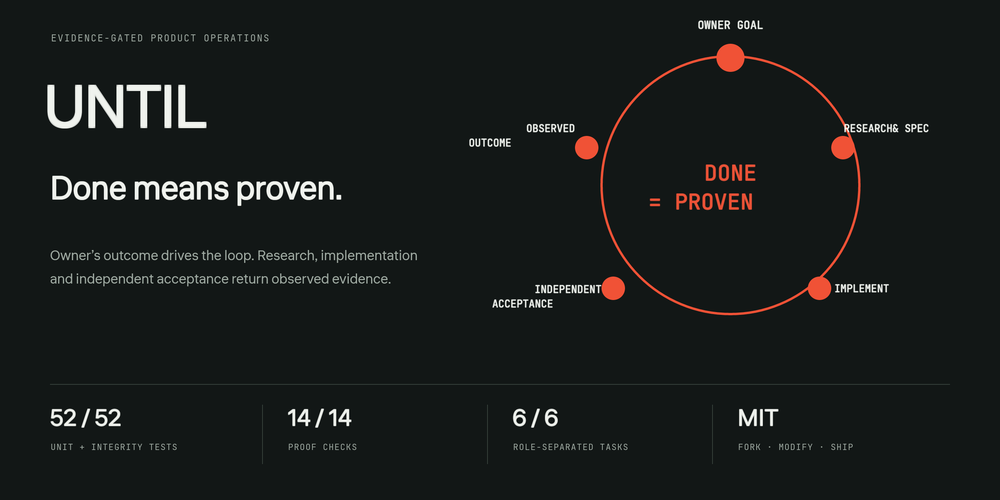
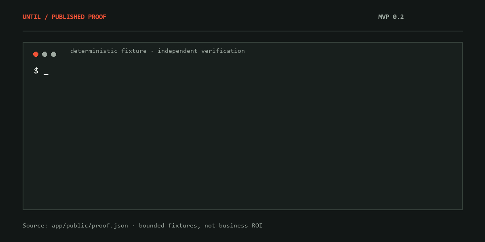
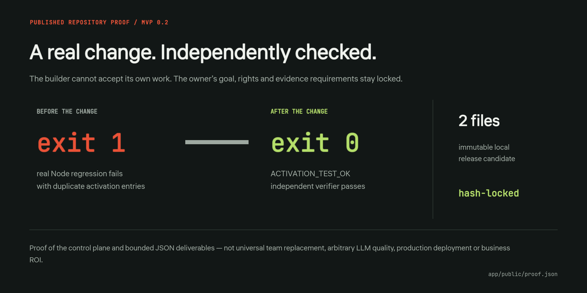

<div align="center">
  
  <p><strong>Done means proven.</strong></p>
  <p>Evidence-gated autonomous product operations. Local-first. Model-neutral. MIT.</p>
  <p>
    <a href="#quick-start">Quick start</a> ·
    <a href="#what-the-current-proof-says">Proof</a> ·
    <a href="docs/architecture.md">Architecture</a> ·
    <a href="BENCHMARKS.md">Benchmarks</a> ·
    <a href="https://balanov.pro/until/">Interactive proof</a> ·
    <a href="README_RU.md">Русский</a>
  </p>
  <p>
    <a href="https://github.com/Balanov/until/actions/workflows/ci.yml"></a>
    <a href="https://github.com/Balanov/until/releases/latest"></a>
    <a href="LICENSE"></a>
    <a href="package.json"></a>
  </p>
</div>

<div align="center">
  
  <p><sub>Published deterministic proof from <a href="app/public/proof.json">app/public/proof.json</a> · 14 / 14 checks. Bounded fixtures, not a business-ROI claim.</sub></p>
</div>

UNTIL is an open autonomous product framework for owners, CEOs and CPOs who want product work to move without manually coordinating every role. You set the business outcome, metric, budget and risk limits. UNTIL turns real customer or product signals into research, the next priority, a bounded specification, implementation, independent acceptance, a verified local release candidate and the next outcome-driven cycle.

**Owner’s goal → research → priority & spec → implementation → independent test → release candidate → observed outcome → next work.**

A finished LLM answer is never accepted as proof of finished product work. The builder cannot accept its own work, and the system cannot rewrite the owner’s goal, grant itself rights or invent missing evidence.

> **Engineering MVP 0.3.** The published proof now includes an actual repository change with a failing-before/passing-after Node test, an immutable two-file release candidate, and a **test-driven repair loop**: the builder is given the project's own failing check as feedback and retries until it passes, with the workspace restored byte for byte if the budget is exhausted. It proves the control plane and a measured improvement on bounded JSON deliverables—not universal team replacement, arbitrary LLM quality, production deployment or business ROI. Start with low-risk, authoritatively verifiable digital-product tasks.

<div align="center">
  
  <p><sub>One real repository change, independent acceptance and a hash-locked local candidate. <a href="app/public/fixtures/repository-run.json">Raw repository cycle</a> · <a href="app/public/proof.json">Proof artifact</a>.</sub></p>
</div>

## What moves without manual coordination

- **Research:** observed incidents, interviews and product signals stay linked to the opportunity they support.
- **Priority and specification:** an open outcome creates the next bounded contract with owner-locked acceptance checks.
- **Implementation:** a deterministic executor or separately sandboxed coding agent receives the contract; nobody needs to chase a status meeting.
- **Test-driven repair:** the builder is handed the project's own failing check and retries until it passes — bounded attempts, allowlisted paths, byte-for-byte restore on exhaustion.
- **Independent acceptance:** another role executes authoritative checks, including a real repository test.
- **Delivery:** accepted files become a content-hashed local release candidate, not an unexamined production deployment.
- **Follow-through:** a post-release observation closes the outcome or creates the next cycle.

## Why another agent framework?

Role-playing teams, PM copilots, coding agents, research moderators and software factories already exist. UNTIL is the neutral outer loop between them:

- **Self-directed work:** open outcome deficits generate tasks; agents do not wait for a new prompt after every answer.
- **Durable execution:** SQLite WAL, leases, retry/backoff, dead-letter, dependencies and crash recovery.
- **Fail-closed stop:** a persistent epoch rejects late completions before they can release dependent work.
- **Evidence gate:** synthetic personas can improve research, but cannot unlock delivery.
- **Role capabilities:** builders never verify themselves; agents cannot grant themselves rights, budgets or evals.
- **Independent acceptance:** file, hash, JSON, content and registered command checks instead of “trust me”.
- **Idempotent delivery:** verified artifacts become local release candidates with content-hash receipts and an outbox.
- **Bounded evolution:** strategy candidates face selection and separate held-out fixtures, safety checks and lineage.
- **Model neutrality:** hosted or local OpenAI-compatible endpoints per role; zero-cost replay fixtures for CI.
- **Honest proof:** raw traces, test reports, benchmarks, limitations and reproducible commands are published with the product.

Read the [market analysis](docs/market-research.md) and [architecture](docs/architecture.md).

## Quick start

Requirements: **Node.js 24+**. The core has **zero runtime npm dependencies** and needs no account, telemetry, model key or network for its deterministic proof.

```sh
git clone https://github.com/Balanov/until.git
cd until
npm ci --ignore-scripts
npm test
npm run proof
node bin/until.mjs demo
```

`demo` runs an explicitly marked deterministic fixture: six role-separated tasks from a real interview fixture to a verified local release candidate, followed by a metric observation and `achieved`. It also evaluates a strategy on held-out fixtures. This proves the loop, not model intelligence.

### Run a goal yourself

```sh
node bin/until.mjs init --goal examples/goal.json
node bin/until.mjs signal add examples/interview.json
node bin/until.mjs run --cycles 8
node bin/until.mjs status
node bin/until.mjs audit
```

State, artifacts and local release candidates live under `.until/` in the selected workspace. The default workspace is the current directory; choose another with `--workspace DIR` or a different database with `--state FILE`.

### Start from a real repository

```sh
node bin/until.mjs init --from-repo /path/to/repo
```

This inspects the repository, detects how the project proves itself (`node --test`, `npm test`, `python -m pytest`, `cargo test`, `go test ./...`, `mvn test`, `gradle test`, `make test`) and writes a ready-to-run goal whose acceptance gate is **the project's own test command**, plus the matching check profile. Merge the generated checks into `until.config.json`, then `until init --goal until.goal.json`.

### Bring evidence in

```sh
node bin/until.mjs import --file support.csv --goal goal_x --kind support --source helpdesk
node bin/until.mjs import --file support.csv --goal goal_x --kind support --source helpdesk --consent
```

Records without an explicit consent assertion are stored with `consent = 0`: they can produce a hypothesis but can never unlock delivery or a release. `--consent` is the operator's assertion that the file carries participant consent.

### Check the installation

```sh
node bin/until.mjs doctor
node bin/until.mjs replay task_123
```

`doctor` reports the runtime version, workspace writability, database integrity, the event hash chain, dead-lettered tasks, expired leases, pending external actions, goals without baseline/target, blocked goals and real-kind signals without consent. `replay` returns a dead-lettered task to the queue without reusing its idempotency key.

Add a post-release observation and run again:

```sh
node bin/until.mjs signal add examples/metric.json
node bin/until.mjs run --cycles 2
```

Try the evidence boundary instead:

```sh
node bin/until.mjs signal add examples/synthetic.json
node bin/until.mjs run --cycles 8
```

A synthetic-only goal produces an interview guide and `waiting_evidence`, not a delivery task.

### Keep the outer loop running

```sh
node bin/until.mjs start
# in another process
node bin/until.mjs stop
node bin/until.mjs reset
```

`start` keeps observing and working without burning tokens while idle. `stop` advances the persistent epoch and rejects late work. `reset` clears the stop latch but never reuses an epoch. Task, model-call and cost budgets are available through `--tasks`, `--model-calls` and `--max-cost`.

## Connect a model

Copy `until.config.example.json` to `until.config.json` and configure models that are actually available. Ollama, LM Studio, llama.cpp and hosted OpenAI-compatible APIs use the same boundary.

```json
{
  "models": {
    "researcher": {
      "type": "openai-compatible",
      "baseURL": "http://127.0.0.1:11434/v1",
      "allowedOrigins": ["http://127.0.0.1:11434"],
      "model": "qwen3:8b",
      "timeoutMs": 120000
    }
  }
}
```

For a hosted provider add `apiKeyEnv` and an optional price card. The **name** of the environment variable is stored in config; the secret is read only from the environment and is never written to SQLite, traces or proof bundles. Unknown cost is `null`, not a fake zero.

Model output is validated against strict role-specific JSON Schemas and existing evidence IDs. Compatible providers receive `response_format: json_schema`; set `structuredOutputs: false` globally or on one model if the endpoint does not support it. External text, tool output and repository content are untrusted data, never authorization. Roles without a configured model use the explicit deterministic fixture implementation.

For a live model delivery, supply authoritative acceptance in the goal. The owner agent may add constraints but cannot discard them; without these checks a live contract stops instead of inventing its own definition of done:

```json
{
  "policy": {
    "acceptance": [
      { "type": "json_field", "field": "implementation.feature", "equals": "preview-import-errors" }
    ]
  }
}
```

`traceResponses: true` opts into storing raw model content for export. Treat it as sensitive: review traces before sharing them. Export a proof bundle with `node bin/until.mjs export --output proof.json`; it includes tasks, verdicts, receipts, events, available model responses and integrity hashes. No secrets are intentionally exported.

## Execution boundary

The built-in executor creates only bounded experiment artifacts inside `.until/artifacts/`. It does not deploy production code.

An external coding harness can be registered as an argv profile with no shell interpolation. It runs only with `sandboxConfirmed: true` in a separately configured OS, VM or container sandbox. It cannot verify itself, publish, change the goal or execute arbitrary model-authored command profiles.

High-risk contracts stop with `blocked_risk` unless a separate risk boundary is deliberately implemented. Production deployment, payments, outreach and IAM changes are outside the default release path.

See [SECURITY.md](SECURITY.md).

### Builder protocol

A builder is a registered argv profile that receives one JSON object on stdin and returns one JSON object on stdout. Two protocols are supported.

**`until-builder/v1`** — the harness edits the workspace itself and returns a summary:

```json
{ "type": "repository_change", "summary": "Removed the duplicate activation step", "repositoryChange": true }
```

**`until-builder/v2`** — the harness returns the edits and the engine applies them, so the same harness can be re-run with the failed check as feedback:

```json
{ "status": "done", "notes": "…", "edits": [{ "path": "src/activation.js", "content": "…" }] }
```

### Test-driven repair loop

When the goal declares `goal.policy.build.testProfile`, the builder runs in a loop:

1. the harness proposes a change;
2. the engine applies it inside the workspace, rejecting any path outside `goal.policy.build.allowedPaths` and any excluded directory;
3. the engine runs the project's own check profile;
4. on failure the harness is re-invoked with the failing output as feedback;
5. when the attempt budget is exhausted the workspace is restored byte for byte and the change is rejected — it can never become a release.

The v1 protocol is adapted automatically: the engine detects what the harness changed and verifies it the same way.

```json
{
  "policy": {
    "acceptance": [{ "type": "command_profile", "profile": "repoTest", "expect": { "exitCode": 0 } }],
    "releasePaths": ["src/activation.js"],
    "build": { "testProfile": "repoTest", "maxAttempts": 3, "allowedPaths": ["src/"] }
  }
}
```

## Evidence types

| Signal | Can create | Cannot prove alone |
|---|---|---|
| Real interview / support / incident | Research and a bounded experiment | Market size or profitability |
| Product metric / payment | Baseline and observed outcome | Causality without an experiment design |
| Reported / public source | A sourced market hypothesis | Your own customer demand |
| Inferred model output | A hypothesis to investigate | Observed evidence |
| Synthetic persona | Research-guide and assumption testing | Delivery or release approval |

## What the current proof says

- **97 / 97** unit, integration and published-evidence integrity tests pass.
- **17 / 17** independent deterministic proof checks pass.
- One real-signal fixture cycle completes **6** role-separated tasks and a later outcome observation.
- A separate repository cycle completes **6/6** role-separated tasks and **6/6** acceptance checks. Its real Node regression test moves from **exit 1** before the fix to **exit 0 / ACTIVATION_TEST_OK** after it. Two accepted files are preserved in an immutable local release candidate; later workspace edits do not alter them. [Raw repository cycle](app/public/fixtures/repository-run.json).
- The **repair loop** is covered end to end and published: a builder that fails the project check is retried with the failing output as feedback; a builder that never satisfies it leaves the workspace byte-identical; a builder that edits outside `goal.policy.build.allowedPaths` is rejected and rolled back. `npm run proof` records the per-attempt trail in `app/public/fixtures/repair-run.json`.
- Late completion after stop is rejected; expired leases recover; duplicate actions are deduplicated; rework is bounded by `goal.policy.maxRevisions` and a goal that cannot satisfy its checks stops as `blocked_rework` instead of burning the task budget.
- The evolver example moves from **0/3 to 3/3 correct held-out fixture rankings**, with no synthetic selection. This is a fixture mechanism check, not real-world improvement. The production loop does not yet rank opportunities by the evolved genome — see the [roadmap](docs/audit/roadmap.md).

### Real model comparison

A frozen protocol ran `qwen3:8b` locally on two selection tasks and two held-out tasks, three times per task and arm. Both arms received the same observation, required feature and acceptance checks. Every run is included.

| Held-out, 6 runs per arm | Accepted | Median wall time | Model calls |
|---|---:|---:|---:|
| UNTIL 0.1 | 0/6 | 9.589 s | 1.5 |
| UNTIL 0.2 | 6/6 | 14.105 s | 3 |
| Direct 0.1 | 1/6 | 3.910 s | 1 |
| Direct 0.2 | 6/6 | 4.299 s | 1 |

The current direct arm is **3.281× faster** than UNTIL and also accepts 6/6. Both current arms received strict JSON Schemas, so the improvement is not attributable to the outer loop alone. UNTIL's added value is durable state, role separation, owner-locked acceptance, independent verification, receipts and the outer outcome loop—not faster one-shot JSON generation.

> **Correction (0.3).** The schema generator had a defect: for nested acceptance paths it accumulated `required` on the child object instead of the declaring parent, producing a schema that required `implementation` inside `implementation`. That malformed schema is the one that was sent to the provider during the published 48 runs. The provider ignored it, and the acceptance verdict was computed from the parsed content, so the accepted/rejected counts above stand — but the "strict JSON Schema" claim was overstated: the schema was neither correct nor enforced. The defect is fixed, model output is now validated locally against the role schema before it reaches an agent, and the published comparison remains the historical record it was.

These are bounded structured-deliverable fixtures, not production code, new customer interviews, a competitor ranking, a business outcome or a team-replacement study. Local provider charges exclude hardware and electricity.

Raw files: [comparison](app/public/comparison.json), [protocol](benchmarks/live-protocol.json), [tasks](benchmarks/live-tasks.json), [48 raw traces](app/public/live/), [raw bundle](app/public/until-proof.zip), [tests](app/public/tests.json), [proof](app/public/proof.json), [benchmarks](app/public/benchmarks.json). Capability sources and comparison limits are in the [market analysis](docs/market-research.md).

Regenerate deterministic checks and package the recorded comparison:

```sh
npm run check
node scripts/test-report.mjs
npm run proof
npm run bench
npm run proof:package
```

To run a new live comparison, use a fresh label and the same local Ollama model; do not overwrite the published historical baseline:

```sh
npm run compare -- --label my-run --system until --suite heldout --repeat 3
npm run compare -- --label my-run --system direct --suite heldout --repeat 3
```

`npm run compare:report` regenerates the published report from the two historical labels. Intrinsic queue/startup measurements are local observations, not competitor rankings or business outcomes. See [BENCHMARKS.md](BENCHMARKS.md).

## The product page

The site is a release-first product page for product teams, in English and Russian. It leads with what a product team gets, shows a real repair run — a failing project test, the builder seeing the failure, and the check going green — and states the security boundary and the limits explicitly. It replays actual engine traces; it does not pretend to call a model in the browser.

```sh
npm ci --prefix app --ignore-scripts
npm run site:build
npm run site:dev -- --host 127.0.0.1 --port 7100
```

Production browser verification (Chrome or Edge):

```sh
npm run validate:site
```

It checks the release-first hero, the visible test and proof counts, the product-team value cards, the role table, the repair proof (the first attempt must show the real failing assertion, the second the green project test), the raw trace downloads, the security claims and exclusions, the release-economics recomputation, the start-here commands, both localizations, every in-page anchor, console errors and failed requests, and horizontal overflow at 375/768/1024/1440 layouts; then it stops its temporary server. `CHROME_BIN` can point to a custom browser executable. Repackaging the raw ZIP uses Python 3 through `npm run proof:package`; the core and deterministic tests need only Node.js.

## Repository map

```text
bin/                 CLI
src/                 SQLite kernel, policy, agents, checks, model router, evolver
src/executor/        Workspace mutation and the test-driven repair loop
scripts/agent/       A real local-model coding agent and the run that records it
test/                Unit, integration and adversarial tests
benchmarks/          Frozen selection and held-out fixtures
scripts/             Syntax, proof, benchmark and report generators
app/                 React + TypeScript product page and honest trace replay
app/public/          Machine-readable proof and raw measurements
examples/            Goal, real interview, metric and synthetic inputs
docs/                Market analysis, architecture and the agent harness
docs/audit/          Technical audit, positioning, roadmap and go-to-market analysis
.github/workflows/   Linux, Windows and macOS CI, plus SAST, audit and SBOM
```

## Run a real agent against the real code

```sh
ollama pull qwen3:14b
npm run agent -- --label my-run --model qwen3:14b --attempts 3
```

This copies this repository, adds a real failing regression test, and hands the job to a local tool-using agent through the real kernel: the agent reads files, runs the project's own check, edits, and retries until it passes or the attempt budget runs out. A separate role then accepts the result, and only a green check becomes a release candidate. The full trace is published to `app/public/fixtures/agent-run.json`.

Any local instruct model works, including a GGUF from an LM Studio library — the agent speaks Ollama's `/api/chat` with a JSON schema, which is llama.cpp grammar:

```sh
printf 'FROM F:\\path\\to\\model.gguf\n\nPARAMETER num_ctx 32768\n' > Modelfile
ollama create my-model -f Modelfile
npm run agent:smoke -- my-model          # can it answer the agent's protocol at all?
npm run agent:sweep -- --models my-model,other-model
```

The agent cannot choose a command, a path outside `goal.policy.build.allowedPaths`, or whether its own work is accepted. See [docs/agent.md](docs/agent.md).

## Roadmap boundaries

Next useful work is connector conformance (real ingestion from issues, tickets and analytics), a signed and attested release path, a public benchmark on real tasks, paired pilots on real repositories, and an HTTP API so the site can drive the engine instead of replaying traces. Self-modifying source code remains a separate research lane with an archive, held-out harness and sandbox—not a hidden production permission.

The full rebuild plan, the open defects and their priority are in [docs/audit/roadmap.md](docs/audit/roadmap.md); the source audit is in [docs/audit/technical-audit.md](docs/audit/technical-audit.md).

No own foundation model is planned until traces and held-out evidence show that a specialized model is the actual bottleneck.

## Related projects

- [uncut](https://github.com/Balanov/uncut) — the lossless, headless coding-agent harness.
- [skein](https://github.com/Balanov/skein) — fail-closed swarm orchestration with epoch-fenced work.
- [held](https://github.com/Balanov/held) — held-out measurement for claimed AI and robot improvements.
- [priemka](https://github.com/Balanov/priemka) — acceptance gates for AI systems before production.


## License and citation

MIT. Fork it, modify it, ship it. See [LICENSE](LICENSE), [CITATION.cff](CITATION.cff), [CREDITS.md](CREDITS.md) and [CHANGELOG.md](CHANGELOG.md).
