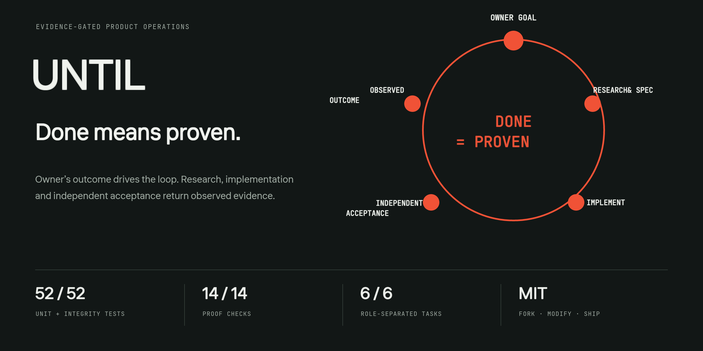
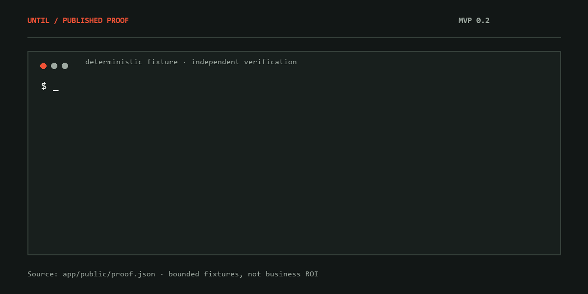
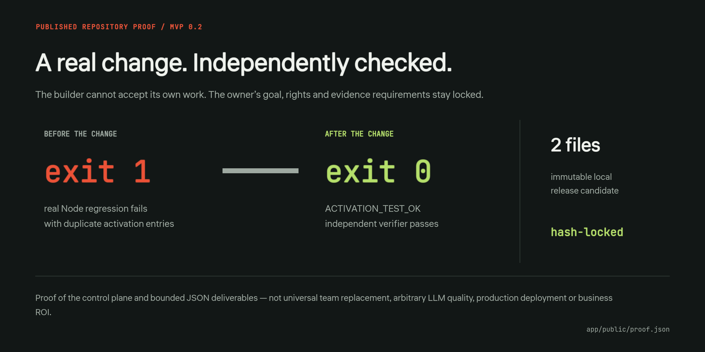

<div align="center">
  
  <p><strong>Готово означает доказано.</strong></p>
  <p>Доказательная автономная продуктовая работа. Local-first. Model-neutral. MIT.</p>
  <p><a href="README.md">English</a> · <a href="#быстрый-старт">Быстрый старт</a> · <a href="#проверяемые-результаты">Proof</a> · <a href="docs/architecture.md">Архитектура</a> · <a href="https://balanov.pro/until/">Интерактивное доказательство</a></p>
</div>

**Открытый автономный продуктовый фреймворк для собственника, CEO и CPO.** Вы задаёте бизнес-результат, метрику, бюджет и допустимый риск. UNTIL исследует реальные сигналы, выбирает следующий приоритет, формирует ТЗ, организует реализацию и независимую приёмку, упаковывает проверенный release candidate и по наблюдаемому результату запускает следующий цикл.

**Цель владельца → исследование → приоритет и ТЗ → реализация → независимый тест → release candidate → наблюдение результата → следующая работа.**

[Рабочее доказательство и интерактивный разбор](https://balanov.pro/until/) · [English README](README.md) · [Архитектура](docs/architecture.md) · [Анализ рынка](docs/market-research.md)

> **Engineering MVP 0.3.** Опубликованный прогон включает реальное изменение кода: Node-тест падает до исправления и проходит после, а два принятых файла сохраняются в неизменяемом release candidate. Добавлен **цикл починки по тесту**: исполнителю передаётся вывод упавшей проверки проекта, и он повторяет попытку, пока тест не станет зелёным; при исчерпании попыток рабочая копия восстанавливается байт в байт. Это доказательство механики control plane, а не универсальная замена команды, качество любой LLM, production-деплой или ROI. Начинайте с низкорисковых цифровых задач с авторитетной проверкой результата.

<div align="center">
  
  <p><sub>Детерминированный proof из <a href="app/public/proof.json">app/public/proof.json</a> · 14 / 14 проверок. Проверка механики, не бизнес-результата.</sub></p>
</div>

<div align="center">
  
  <p><sub>Реальное изменение, независимая приёмка и локальный candidate с фиксированным hash. <a href="app/public/fixtures/repository-run.json">Сырой цикл репозитория</a>.</sub></p>
</div>

## Что движется без ручной координации

- **Исследование:** инциденты, интервью и продуктовые сигналы остаются связаны с возможностью, которую поддерживают.
- **Приоритет и ТЗ:** незакрытый результат создаёт следующий ограниченный контракт с критериями приёмки владельца.
- **Реализация:** deterministic executor или отдельно изолированный coding-agent получает контракт без очередной статус-встречи.
- **Починка по тесту:** исполнителю отдаётся вывод упавшей проверки проекта, он повторяет попытку до зелёного теста; правки ограничены allowlist'ом, при исчерпании бюджета рабочая копия откатывается байт в байт.
- **Независимая приёмка:** другая роль выполняет авторитетные проверки, включая настоящий тест репозитория. Исполнитель не принимает собственную работу.
- **Delivery:** принятые файлы становятся локальным release candidate с content hash, а не непроверенным production-деплоем.
- **Следующий цикл:** наблюдение после выпуска закрывает результат или создаёт следующую работу.

UNTIL не может переписать цель владельца, выдать себе права или придумать недостающее доказательство.

## Почему это не ещё один чат с ролями

- Незакрытые цели сами создают следующую работу.
- SQLite WAL, leases, retries, dead-letter и восстановление после сбоя.
- Persistent epoch stop отклоняет поздние результаты до публикации.
- Synthetic personas улучшают исследование, но не открывают delivery.
- Builder никогда не проверяет собственную работу.
- Acceptance checks исполняются независимой ролью.
- Release candidate идемпотентен и получает content-hash receipt.
- Стратегии улучшаются только через selection и отдельные held-out fixtures.
- Hosted и локальные OpenAI-compatible модели подключаются по ролям; replay работает бесплатно.
- Тесты, исходные следы, benchmarks и ограничения опубликованы.

## Быстрый старт

Требуется **Node.js 24+**. В ядре нет runtime npm-зависимостей, аккаунта, телеметрии или обязательного ключа модели.

```sh
git clone https://github.com/Balanov/until.git
cd until
npm ci --ignore-scripts
npm test
npm run proof
node bin/until.mjs demo
```

`demo` — явно обозначенная детерминированная фикстура: 6 ролевых задач до локального release candidate, затем наблюдение метрики и `achieved`. Это проверка механики, не интеллекта модели или бизнес-эффекта.

## Своя цель и сигналы

```sh
node bin/until.mjs init --goal examples/goal.json
node bin/until.mjs signal add examples/interview.json
node bin/until.mjs run --cycles 8
node bin/until.mjs signal add examples/metric.json
node bin/until.mjs run --cycles 2
node bin/until.mjs status
node bin/until.mjs audit
```

Для проверки evidence gate добавьте `examples/synthetic.json`: получится research guide и `waiting_evidence`, но не delivery.

### Старт из настоящего репозитория

```sh
node bin/until.mjs init --from-repo /path/to/repo
```

Команда определяет, как проект доказывает сам себя (`node --test`, `npm test`, `python -m pytest`, `cargo test`, `go test ./...`, `mvn test`, `gradle test`, `make test`) и пишет готовую цель, где критерий приёмки — **собственный тестовый набор проекта**, плюс профиль проверки.

### Импорт доказательств и проверка установки

```sh
node bin/until.mjs import --file support.csv --goal goal_x --kind support --source helpdesk --consent
node bin/until.mjs doctor
node bin/until.mjs replay task_123
```

Без `--consent` записи сохраняются с `consent = 0`: они порождают гипотезу, но не могут открыть delivery или выпуск. `doctor` проверяет версию Node, доступность рабочей копии, целостность БД и hash-chain, dead-letter, просроченные lease, pending outbox, заблокированные цели и сигналы без согласия. `replay` возвращает dead-letter задачу в очередь, не переиспользуя её idempotency-ключ.

Непрерывный режим:

```sh
node bin/until.mjs start
# из другого процесса
node bin/until.mjs stop
node bin/until.mjs reset
```

`start` ждёт сигналы без бесполезного расхода токенов. `stop` увеличивает epoch и отклоняет позднюю работу. `reset` снимает latch, но не использует epoch повторно.

## Модели и исполнение

Скопируйте `until.config.example.json` в `until.config.json`. Поддерживаются Ollama, LM Studio, llama.cpp и hosted OpenAI-compatible API. Секрет передаётся только через env-переменную; в БД и proof он не сохраняется. Неизвестная стоимость — `null`, а не ноль.

Совместимые провайдеры получают строгие JSON Schema для ролей. Если endpoint их не поддерживает, задайте `structuredOutputs: false` глобально или для конкретной модели. Для live delivery владелец цели обязан задать `goal.policy.acceptance`: модель может добавить ограничения, но не отбросить внешние критерии. Без них контракт останавливается fail-closed, а не придумывает собственное «готово».

`traceResponses: true` включает сохранение сырых ответов модели. Они могут содержать чувствительные данные и по умолчанию выключены. Команда `node bin/until.mjs export --output proof.json` экспортирует задачи, вердикты, квитанции, события, доступные ответы и SHA-256-хэши. Проверяйте следы перед публикацией.

Встроенный executor создаёт только ограниченные артефакты в `.until/artifacts/`. Внешний coding-agent запускается как заранее зарегистрированный argv-профиль без shell interpolation и только при `sandboxConfirmed: true` в отдельной OS/VM/container sandbox. High-risk контракты по умолчанию останавливаются. Production, платежи, outreach и IAM не входят в стандартный release path. Подробнее: [SECURITY.md](SECURITY.md).

## Проверяемые результаты

- **97 / 97** unit/integration и integrity-тестов опубликованных данных.
- **17 / 17** независимых детерминированных proof-проверок.
- **6** ролевых задач в real-signal цикле и последующее наблюдение.
- Отдельный репозиторный цикл: **6/6** ролевых задач и **6/6** проверок приёмки. Настоящий Node-тест меняется с **exit 1** до исправления на **exit 0 / ACTIVATION_TEST_OK** после. Два принятых файла сохраняются в неизменяемом локальном release candidate; последующие правки рабочей копии их не меняют. [Сырой JSON цикла](app/public/fixtures/repository-run.json).
- Цикл починки проверен end-to-end и опубликован: исполнитель, проваливший тест проекта, повторяется с выводом ошибки; исполнитель, не удовлетворяющий проверке, оставляет рабочую копию байт-в-байт прежней; правка вне `goal.policy.build.allowedPaths` отклоняется и откатывается. `npm run proof` пишет след по каждой попытке в `app/public/fixtures/repair-run.json`.
- Late completion отклонён, lease восстановлен, дубликаты действий дедуплицированы, rework ограничен `goal.policy.maxRevisions`.
- Evolver: **0/3 → 3/3** правильных held-out fixture rankings. Это проверка механизма, не реальный продуктовый рост. Продуктовый цикл пока не ранжирует возможности по эволюционировавшему геному — см. [роадмап](docs/audit/roadmap.md).

### Замер на настоящей локальной модели

Замороженный протокол: `qwen3:8b` через Ollama, две selection- и две отдельные held-out-задачи, три повтора. У обоих подходов одинаковые наблюдение, требуемая функция и критерии приёмки. Включены все запуски и ошибки.

| Held-out, 6 запусков на подход | Принято | Медиана времени | Вызовов модели |
|---|---:|---:|---:|
| UNTIL 0.1 | 0/6 | 9,589 с | 1,5 |
| UNTIL 0.2 | 6/6 | 14,105 с | 3 |
| Direct 0.1 | 1/6 | 3,910 с | 1 |
| Direct 0.2 | 6/6 | 4,299 с | 1 |

Новый direct быстрее нового UNTIL в **3,281 раза** и тоже получил 6/6. Оба новых подхода используют strict JSON Schema, поэтому весь прирост нельзя приписывать outer loop. UNTIL добавляет durable state, разделение ролей, независимую приёмку, квитанции и следующий цикл по исходу, а не ускоряет одноразовую генерацию JSON.

> **Поправка (0.3).** В генераторе схем был дефект: для вложенных путей приёмки список `required` накапливался на дочернем объекте, а не на объявляющем родителе, из-за чего схема требовала `implementation` внутри `implementation`. Именно эта некорректная схема уходила провайдеру в опубликованных 48 прогонах. Провайдер её проигнорировал, а вердикт приёмки считался по разобранному содержимому, поэтому числа выше остаются верными — но утверждение о «strict JSON Schema» было преувеличено: схема была и неверной, и не проверялась. Дефект исправлен, ответ модели теперь валидируется локально по ролевой схеме до передачи агенту, а опубликованное сравнение остаётся исторической записью, которой оно было.

Это ограниченные структурированные артефакты, не production-код, не новые интервью, не рейтинг конкурентов, не бизнес-результат и не исследование замены команды. Стоимость локального API не включает железо и электричество.

Исходники: [сравнение](app/public/comparison.json), [протокол](benchmarks/live-protocol.json), [задачи](benchmarks/live-tasks.json), [48 сырых traces](app/public/live/), [архив](app/public/until-proof.zip), [tests](app/public/tests.json), [proof](app/public/proof.json), [benchmarks](app/public/benchmarks.json). Первоисточники и границы матрицы — в [анализе рынка](docs/market-research.md).

```sh
npm run check
node scripts/test-report.mjs
npm run proof
npm run bench
npm run proof:package
```

Новый live-замер запускается через `npm run compare -- --label my-run --system until --suite heldout --repeat 3`; для direct замените систему на `direct`. Используйте новый label, не перезаписывая исторический baseline. `npm run compare:report` собирает опубликованный отчёт из двух зафиксированных наборов. Intrinsic benchmark измеряет локальную механику, а не качество агентов или бизнес-результат.

## Страница продукта

Сайт — продуктовая страница для продуктовых команд, на английском и русском. Сначала показывает, что получает команда, потом — реальный прогон починки: упавший тест проекта, исполнитель, который увидел ошибку, и зелёная проверка. Отдельно и прямо названы границы безопасности и честные ограничения. Сайт проигрывает настоящие следы движка и не имитирует вызов модели в браузере.

```sh
npm ci --prefix app --ignore-scripts
npm run site:build
npm run site:dev -- --host 127.0.0.1 --port 7100
npm run validate:site
```

## Границы

UNTIL не подменяет реальных клиентов синтетическими персонами. Агенты могут модерировать и анализировать без исследовательской команды, но реальные люди остаются источником наблюдений и поведения. Собственная LLM не нужна для доказательства основной ценности. Универсальные «10×» и экономия ФОТ заявляются только после парных пилотов на реальных задачах конкретной компании.

## Лицензия

MIT. Форкайте, изменяйте, публикуйте. [LICENSE](LICENSE) · [CITATION.cff](CITATION.cff) · [CREDITS.md](CREDITS.md)
